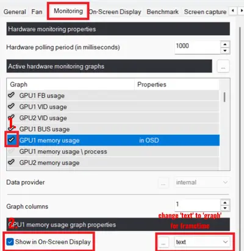
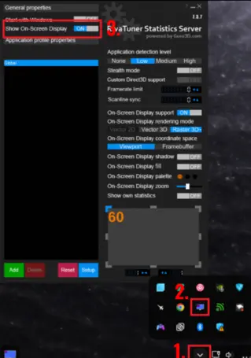

## Installing MSI Afterburner
Download MSI Afterburner from [here.](https://sg.msi.com/Landing/afterburner/graphics-cards) Make sure to download the version labeled as 'Final' to avoid instability.

Once downloaded, extract the zip file and run the installer inside.
> [!IMPORTANT] Important
>
> MSI frequently bundles Norton 360 in the Afterburner installer; make sure to uncheck the box for it when first launching the installer!
## Setting up the overlay
Once Afterburner is installed and open, click the settings icon in the top left. From there, navigate to the "On-Screen Display" tab and set your global hotkeys.

Afterwards, head to the "Monitoring" tab and toggle the check and "Show in On-Screen Display" property for the following attributes:

GPU Temperature\
GPU Usage\
GPU Memory Usage\
GPU Core Clock\
GPU Memory Clock\
GPU Power\
CPU Temperature\
CPU Usage\
CPU Clock\
CPU Power\
RAM Usage\
Framerate\
Frametime **(Note: make sure frametime is set to be a graph rather than text.)**\
Framerate 1% Low
##### Once done, click **apply** then **ok** and minimize Afterburner.

## Monitoring in-game
Before hopping into a game, we need to make sure the OSD is on. To do this open your system tray, click the RivaTuner icon, and make sure 'Show On-Screen Display' is turned **ON**.

Now you can launch your game. If you don't see the overlay upon launch, press the hotkey you assigned for toggling the OSD.

If receiving assistance in the discord, play with the overlay enabled until your issue begins. Once your issue starts, take a screenshot or short recording of **the entire game window** and send it in the server.

> [!TIP] Tip
> 
> For a more in-depth static analysis, refer to [our HWiNFO guide.](https://rtech.support/guides/hwinfo/)