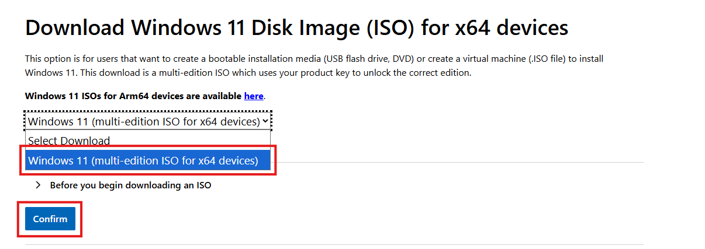

> [!IMPORTANT] Important
>
> This guide only covers creating the Windows install USB! For the installation steps, continue on from the step in [Installing Windows 11 page](../install-11/#bios-and-setup) after creating the MCT!

## Prerequisites

* An internet connection.
* A working Linux computer (Any distro).
* A USB flash drive that is at least 16 GB or greater.

> [!NOTE] Why not an 8 GB USB?
>
> The ISO file utilized in this install method is greater than 8 GB for modern Windows versions (26H2 is 8.4 GB for example). A 8 GB USB unfortunately only has 7.45 GB of usable space, and therefore will not be able to be utilized for this procedure.
>
> The installer created by Windows MCT however is different and can still be contained within the 8 GB limit published by Microsoft for installation requirements.

Do note that simply dropping the ISO file into the USB will not make it bootable! You need to properly flash the USB drive such that the BIOS of the target system will acknowledge it and boot the installer.

> [!CAUTION] Caution
>
> This procedure will wipe the USB Flash drive, so ensure you have nothing important on the USB drive, and back up all important documents.

## Creating and preparing the installation media

### Downloading the ISO

Download the Windows 11 ISO file from the [Download Windows 11](https://www.microsoft.com/en-us/software-download/windows11) page. Scroll down to the section titled "**Download Windows 11 Disk Image (ISO) for x64 devices**" and select the download option.

> [!NOTE] Information
>
> The options "**Windows 11 Installation Assistant**" and "**Create Windows 11 Installation Media**" (if visible) cannot be used as those are `.exe` file downloads, which will not work on Linux.

Once this is done, there are numerous ways of flashing the ISO to the USB drive. This guide will cover two of them:

* Using Ventoy to create a bootable environment for the USB.
* Manual flashing of the ISO using `wimlib`/`wimtools`, `dosfstools`, `mtools`, `parted` and `rsync`.

### Method 1: Using Ventoy (Easy Method)

Follow the [Linux instructions of our Ventoy guide](../../guides/ventoy/#linux) to create the bootable Environment. Then follow the usage section in order to understand how to use it.

## Post Windows Install Media creation steps

Once the flashing is complete, you can now insert it into the target computer to install Windows to. Continue on from the step in [Installing Windows 11 page](../install-11/#bios-and-setup) after creating the MCT.
